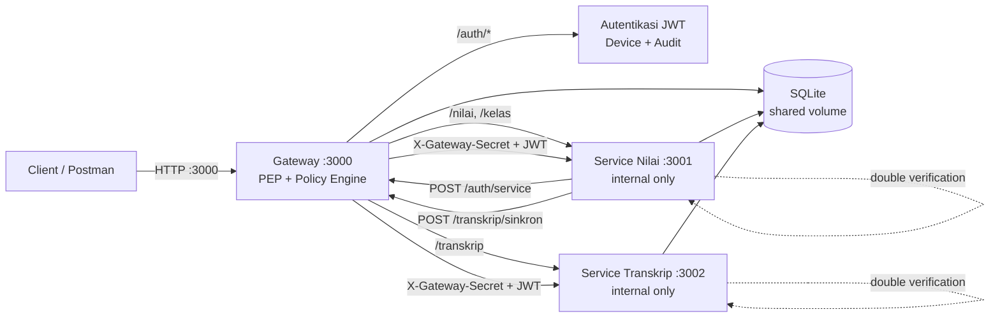

# Panduan Video Demo 6–9 Menit — Sistem Nilai Zero Trust

Panduan ini disusun untuk **Luaran 2: Video Demo**. Fokus penilaian adalah **mekanisme kontrol akses**, bukan tampilan. Karena itu seluruh demo dilakukan melalui **Postman dan terminal**, bukan frontend.

**Target durasi:** 8 menit 30 detik (bisa dipotong menjadi 6 menit atau diperpanjang menjadi 9 menit).
**Resolusi:** 1080p, font terminal/editor minimal 16 pt.
**Output:** video MP4, audio jelas, tanpa data rahasia yang terbaca.

---

## 1. Ringkasan Alur dan Alokasi Waktu

| Waktu | Bagian | Fokus | Bukti yang ditunjukkan |
| :--- | :--- | :--- | :--- |
| 0:00–0:50 | Pembukaan & arsitektur | Gateway satu-satunya pintu masuk | Diagram, `docker-compose.yml`, `docker compose ps` |
| 0:50–2:45 | Autentikasi, JWT, konteks | Login, token TTL, device, refresh, logout | Postman Auth + Negative Cases |
| 2:45–4:45 | Kebijakan akses | Least privilege & ABAC | Postman mahasiswa/dosen/admin, `policy.js` |
| 4:45–6:15 | Assume breach | Double verification | `proxy.js`, middleware service, serangan internal |
| 6:15–7:25 | Antar-service | Finalisasi & sinkronisasi | `kelas.js`, `gateway-client.js`, service token |
| 7:25–8:15 | Audit log | Semua keputusan tercatat | Query `AuditLog`, `audit.js` |
| 8:15–8:45 | Penutup | Rekap pemenuhan kebutuhan | Ringkasan lisan |

### Jika harus 6 menit

Potong bagian berikut:

- Lewati demo login ulang setelah logout; gunakan access token yang masih valid.
- Lewati test `PUT /nilai` skor invalid dan `GET /nilai` tanpa device.
- Tampilkan satu request service token saja; tidak perlu mengulang manual sync.
- Audit log cukup 10 baris terakhir.

### Jika ingin 9 menit

Tambahkan:

- Demo `GET /nilai` untuk mahasiswa dan dosen.
- Demo penolakan admin di endpoint nilai.
- Demo `POST /transkrip/sinkron` manual memakai service token.
- Demo token lama setelah refresh ditolak.

---

## 2. Persiapan Sebelum Merekam

### 2.1 Reset database ke kondisi seed bersih

Jalankan dari root proyek:

```powershell
docker compose down
Remove-Item database\zerotrust.db,database\zerotrust.db-wal,database\zerotrust.db-shm -ErrorAction SilentlyContinue
docker compose up -d
docker compose ps
Invoke-RestMethod http://127.0.0.1:3000/health
```

Pastikan semua container `healthy` dan health gateway mengembalikan:

```json
{
  "status": "ok",
  "service": "gateway",
  "phase": "phase-2-3"
}
```

> Jika `.env` belum ada, jalankan `npm run env:init` sebelum `docker compose up -d`.

### 2.2 Pastikan berada dalam jam operasional

Perubahan dan finalisasi nilai hanya diizinkan pada **[07:00, 21:00) Asia/Jakarta**. Cek waktu:

```powershell
docker compose exec gateway node -e "console.log(new Intl.DateTimeFormat('en-GB',{timeZone:'Asia/Jakarta',hour:'2-digit',minute:'2-digit',hourCycle:'h23'}).format(new Date()))"
```

Rekam demo finalisasi pada jam tersebut. Jika merekam di luar jam, finalisasi akan menghasilkan `403 outside_operational_hours`; itu bisa dijadikan demo tambahan, tetapi jangan dijadikan demo utama.

### 2.3 Siapkan Postman

1. Import `postman/zero-trust-system.postman_collection.json`.
2. Pastikan collection variable `gateway_url` = `http://localhost:3000`.
3. Isi `service_client_secret` dengan nilai `SERVICE_CLIENT_SECRET` dari `.env`.
   - **Jangan tampilkan nilai secret di video.**
   - Lakukan pengisian sebelum mulai merekam, atau sembunyikan bagian layar tersebut.
4. Jalankan `Health Check → Gateway - GET /health`.
5. Jangan jalankan seluruh collection dengan Collection Runner sebelum rekaman jika ingin mengatur urutan demo secara manual.

### 2.4 Siapkan jendela yang akan direkam

Susun layar agar perpindahan cepat:

- **Postman** — collection `Sistem Nilai Zero Trust - Fase 2 & 3`.
- **VS Code** — buka file kode yang akan ditunjukkan.
- **Terminal PowerShell** — untuk `docker compose`, serangan internal, dan audit.
- **Browser/Preview** — diagram arsitektur (README atau slide).
- **Database viewer opsional** — boleh digunakan, tetapi terminal lebih cepat dan tidak perlu instalasi tambahan.

### 2.5 Data demo yang dipakai

| Role | Username | Password | Device ID |
| :--- | :--- | :--- | :--- |
| Admin | `admin` | `Admin#2026` | `device-admin-01` |
| Dosen 1 | `dosen1` | `Dosen#2026` | `device-dosen1-01` |
| Dosen 2 | `dosen2` | `Dosen#2026` | `device-dosen2-01` |
| Mahasiswa 1 | `20231001` | `Mhs#2026` | `device-20231001-01` |
| Mahasiswa 2 | `20231002` | `Mhs#2026` | `device-20231002-01` |
| Mahasiswa 3 | `20231003` | `Mhs#2026` | `device-20231003-01` |

Data awal:

- Kelas `1`: Pemrograman Web — dosen `dosen1`.
- Kelas `2`: Kecerdasan Buatan — dosen `dosen2`.
- Nilai `1`–`3`: kelas 1, milik `20231001`–`20231003`, status `draft`.
- Nilai `4`–`6`: kelas 2, milik `20231001`–`20231003`, status `draft`.
- Transkrip ketiga mahasiswa awalnya `[]`.

---

## 3. Diagram Arsitektur untuk Scene 1

Tampilkan diagram berikut pada slide, README, atau Markdown preview. Jika Markdown viewer mendukung Mermaid, blok ini akan langsung menjadi diagram.



Poin yang harus diucapkan:

- Hanya gateway yang punya mapping port ke host.
- Service Nilai dan Service Transkrip hanya ada di network internal `zt-network`.
- Gateway adalah PEP sekaligus Policy Engine/Administrator.
- Service tetap memverifikasi ulang secret dan JWT (*assume breach*).

---

## 4. Scene 1 — Pembukaan & Arsitektur (0:00–0:50)

### Tujuan

Membuktikan bahwa arsitektur deployment menerapkan *single entry point* dan port internal tidak terbuka.

### Langkah di layar

1. Tampilkan diagram arsitektur.
2. Buka `docker-compose.yml`.
3. Sorot bagian gateway:

```yaml
ports:
  - "3000:3000"
```

4. Sorot service-nilai:

```yaml
expose:
  - "3001"
```

5. Sorot service-transkrip:

```yaml
expose:
  - "3002"
```

6. Sorot network:

```yaml
networks:
  zt-network:
    name: zt-network
    driver: bridge
```

7. Buka terminal dan jalankan:

```powershell
docker compose ps
```

Tunjukkan bahwa hanya gateway yang memiliki port publish ke host. Service Nilai dan Service Transkrip hanya berstatus `expose`.

8. Opsional, tunjukkan akses host ke port internal gagal:

```powershell
Invoke-WebRequest http://127.0.0.1:3001/health -TimeoutSec 3
Invoke-WebRequest http://127.0.0.1:3002/health -TimeoutSec 3
```

Keduanya harus gagal koneksi.

### Narasi contoh

> “Ini adalah Sistem Nilai Zero Trust. Ada tiga komponen: Gateway di port 3000, Service Nilai di port 3001, dan Service Transkrip di port 3002. Pada `docker-compose.yml`, hanya gateway yang memiliki mapping `ports: 3000:3000`. Dua service lainnya hanya memakai `expose`, sehingga tidak dapat diakses langsung dari host. Gateway berperan sebagai Policy Enforcement Point dan Policy Engine, sedangkan kedua service adalah resource yang tetap melakukan verifikasi ulang. Semua berada dalam network internal `zt-network` dan berbagi database SQLite.”

### Rujukan kode

| File | Bagian |
| :--- | :--- |
| `docker-compose.yml` | baris 15–16 (`gateway.ports`), 73–74 (`service-nilai.expose`), 116–117 (`service-transkrip.expose`), 150–153 (`zt-network`) |
| `README.md` | bagian 1 “Arsitektur Singkat” |
| `gateway/src/index.js` | komentar peran gateway sebagai PEP/PE-PA, baris 3–11 |

---

## 5. Scene 2 — Autentikasi, JWT, dan Verifikasi Konteks (0:50–2:45)

### Tujuan

Menunjukkan:

- Login berhasil dengan device yang benar.
- Access token 10 menit dan refresh token 1 hari.
- Device yang salah ditolak.
- Refresh token dirotasi.
- Logout mencabut refresh token.

### 5.0 Siapkan token semua peran

Sebelum demo dimulai, jalankan tiga request berikut agar collection variable berisi token yang dibutuhkan pada scene kebijakan akses:

```text
Auth → Login Admin
Auth → Login Dosen 1
Auth → Login Dosen 2
```

Cukup tunjukkan status `200` dan role yang sesuai. Tidak perlu memperlihatkan isi token panjang. Token mahasiswa akan diperoleh pada langkah berikutnya.

### 5.1 Login mahasiswa berhasil

Di Postman, jalankan:

```text
Auth → Login Mahasiswa
```

Request:

```http
POST http://localhost:3000/auth/login
Content-Type: application/json
X-Device-ID: device-20231001-01

{
  "username": "20231001",
  "password": "Mhs#2026"
}
```

Response yang ditunjukkan:

```json
{
  "access_token": "<access-jwt>",
  "refresh_token": "<refresh-token>",
  "token_type": "Bearer",
  "expires_in": 600,
  "refresh_expires_in": 86400,
  "user": {
    "id": 4,
    "username": "20231001",
    "role": "mahasiswa"
  }
}
```

Yang dijelaskan:

- `expires_in: 600` = access token 10 menit.
- `refresh_expires_in: 86400` = refresh token 1 hari.
- Access token ditandatangani dengan HS256, memiliki `sub`, `role`, `token_use: access`, issuer, audience, dan expiry.
- Refresh token disimpan di database sebagai hash SHA-256, bukan teks mentah.

### 5.2 Device salah ditolak

Jalankan request negative case:

```text
Negative Cases → Login - Device bukan milik user
```

Request memakai kredensial `dosen1`, tetapi device milik mahasiswa:

```http
POST http://localhost:3000/auth/login
Content-Type: application/json
X-Device-ID: device-20231003-01

{
  "username": "dosen1",
  "password": "Dosen#2026"
}
```

Response:

```json
{
  "error": "forbidden",
  "reason": "device_not_registered"
}
```

Status: `403`.

Opsional, tunjukkan juga:

```text
Negative Cases → Login - Tanpa device
```

Response: `401 device_id_required`.

### 5.3 Refresh token dan rotasi

Jalankan:

```text
Auth → Refresh Mahasiswa (rotasi token)
```

Request:

```http
POST http://localhost:3000/auth/refresh
Content-Type: application/json
X-Device-ID: device-20231001-01

{
  "refresh_token": "{{mahasiswa_refresh_token}}"
}
```

Response berisi access token baru dan refresh token baru. Jelaskan bahwa token lama langsung dihapus, sehingga replay token lama gagal.

Postman collection otomatis memperbarui variable `mahasiswa_token` dan `mahasiswa_refresh_token`.

### 5.4 Logout

Jalankan:

```text
Auth → Logout Mahasiswa
```

Response:

```json
{
  "message": "logged_out"
}
```

Jelaskan:

- Logout mencabut refresh token yang dikirim.
- Access token yang sudah terbit tetap valid sampai expiry maksimal 10 menit. Ini konsekuensi desain stateless access token dan disebutkan secara eksplisit di kode.

### 5.5 Login ulang untuk scene berikutnya

Setelah logout, jalankan lagi:

```text
Auth → Login Mahasiswa
```

Ini memastikan scene kebijakan akses memakai sesi baru. Access token lama sebenarnya masih valid, tetapi login ulang membuat alur demo lebih bersih.

### Narasi contoh

> “Login membutuhkan tiga hal: username, password, dan `X-Device-ID` yang terdaftar. Response menunjukkan access token berlaku 600 detik dan refresh token 86.400 detik. Access token ditandatangani HS256 dan membawa role serta `token_use`. Refresh token bersifat stateful dan dirotasi setiap kali dipakai. Ketika saya memakai device milik mahasiswa lain untuk login sebagai dosen, sistem menolak dengan `403 device_not_registered`. Ini adalah verifikasi konteks, bukan hanya username dan password. Setelah refresh, token lama tidak berlaku. Logout mencabut refresh token, sedangkan access token tetap valid sampai expiry sesuai desain stateless.”

### Rujukan kode

| File | Bagian yang ditunjukkan |
| :--- | :--- |
| `gateway/src/routes/auth.js` | login baris 63–139; refresh 147–254; logout 262–318; service token 327–366 |
| `gateway/src/lib/tokens.js` | `signAccessToken` 13–28; `signServiceToken` 34–50; `verifyToken` 56–63; hash refresh token 65–72; `safeEqual` 81–86 |
| `gateway/src/config.js` | TTL dan pembacaan env, baris 64–83 |
| `gateway/src/middleware/authenticate.js` | verifikasi JWT 47–53; device binding 105–112 |
| `prisma/schema.prisma` | model `RefreshToken`, baris 31–37 |

---

## 6. Scene 3 — Kebijakan Akses: Least Privilege & ABAC (2:45–4:45)

### Tujuan

Menunjukkan aturan berbeda untuk mahasiswa, dosen, dan admin, serta keputusan yang membaca atribut database.

### 6.1 Mahasiswa: transkrip sendiri vs transkrip orang lain

Jalankan:

```text
Transkrip → GET /transkrip/:nim - Mahasiswa sendiri
```

Request:

```http
GET http://localhost:3000/transkrip/20231001
Authorization: Bearer {{mahasiswa_token}}
X-Device-ID: device-20231001-01
```

Response: `200`, dengan `nim: "20231001"` dan `data_nilai: []` (sebelum finalisasi).

Lalu jalankan:

```text
Transkrip → GET /transkrip/:nim - Mahasiswa lain (deny)
```

Request:

```http
GET http://localhost:3000/transkrip/20231003
Authorization: Bearer {{mahasiswa_token}}
X-Device-ID: device-20231001-01
```

Response:

```json
{
  "error": "forbidden",
  "reason": "transkrip_forbidden"
}
```

Status: `403`.

### 6.2 Dosen: kelas sendiri vs kelas dosen lain

Jalankan:

```text
Nilai → PUT /nilai/:id - Dosen pengampu
```

Request:

```http
PUT http://localhost:3000/nilai/1
Authorization: Bearer {{dosen_token}}
X-Device-ID: device-dosen1-01
Content-Type: application/json

{
  "skor": 87
}
```

Response: `200`, nilai `1` berubah menjadi `87`, status masih `draft`.

Lalu jalankan:

```text
Nilai → PUT /nilai/:id - Dosen lain (deny)
```

Request memakai `dosen2_token` dan device `dosen2`, tetap ke nilai `1` yang merupakan kelas `dosen1`:

```http
PUT http://localhost:3000/nilai/1
Authorization: Bearer {{dosen2_token}}
X-Device-ID: device-dosen2-01
Content-Type: application/json

{
  "skor": 87
}
```

Response:

```json
{
  "error": "forbidden",
  "reason": "class_not_owned"
}
```

Status: `403`.

Opsional, tunjukkan validasi skor:

```text
Nilai → PUT /nilai/:id - Skor invalid (sebelum final)
```

Response: `400 invalid_skor`.

### 6.3 Admin: transkrip seluruh mahasiswa

Jalankan:

```text
Transkrip → GET /transkrip/:nim - Admin
```

Request:

```http
GET http://localhost:3000/transkrip/20231001
Authorization: Bearer {{admin_token}}
X-Device-ID: device-admin-01
```

Response: `200`, admin dapat membaca transkrip mahasiswa.

Opsional, tunjukkan admin ditolak dari endpoint nilai:

```text
Nilai → GET /nilai - Admin (deny)
```

Response: `403 role_not_allowed`.

### 6.4 Tunjukkan `policy.js`

Buka `gateway/src/policy.js` dan sorot:

1. `enforceNilaiUpdate` — baris 66–100:
   - hanya role `dosen`;
   - cek jam operasional;
   - baca `nilai.kelas.dosenId` dari database;
   - bandingkan dengan `req.auth.userId`;
   - tolak nilai `final`.

2. `enforceTranskripRead` — baris 131–163:
   - hanya `mahasiswa` dan `admin`;
   - mahasiswa: baca `username` dari database lalu bandingkan dengan NIM yang diminta;
   - admin: boleh membaca semua mahasiswa.

3. `enforcePolicy` — baris 188–250:
   - routing exact-path;
   - setiap route yang tidak cocok ditolak `404 route_not_allowed`;
   - semua keputusan memanggil `allow()` atau `deny()`.

Jelaskan bahwa keputusan **tidak** didasarkan pada input client seperti `role` di body, tetapi pada:
- JWT yang sudah diverifikasi;
- role user di database;
- relasi kelas–dosen;
- kepemilikan NIM.

### Narasi contoh

> “Di sini terlihat least privilege. Mahasiswa hanya boleh membaca transkrip dengan NIM yang sama dengan username-nya. Ketika saya meminta NIM mahasiswa lain, gateway menolak dengan `transkrip_forbidden`. Dosen hanya boleh mengubah nilai pada kelas yang diampu. Saya coba dengan dosen1, berhasil. Saya coba nilai yang sama dengan dosen2, ditolak `class_not_owned`. Admin boleh membaca transkrip semua mahasiswa, tetapi tidak boleh mengakses endpoint nilai. Keputusan ini diambil di `policy.js` dengan membaca atribut dari database: `kelas.dosenId`, role user, dan username mahasiswa. Jadi bukan sekadar mengecek role, tetapi juga relasi kepemilikan.”

### Rujukan kode

| File | Bagian |
| :--- | :--- |
| `gateway/src/policy.js` | `enforceNilaiUpdate` 66–100; `enforceFinalisasi` 102–129; `enforceTranskripRead` 131–163; `enforceTranskripSync` 165–180; `enforcePolicy` 188–250 |
| `gateway/src/middleware/authenticate.js` | role dari database 92–103 |
| `service-nilai/src/routes/nilai.js` | scoping GET 39–51; cek ulang kepemilikan 76–108 |
| `service-transkrip/src/routes/transkrip.js` | cek NIM sendiri 129–176 |

---

## 7. Scene 4 — Assume Breach & Double Verification (4:45–6:15)

### Tujuan

Membuktikan bahwa service tidak mempercayai gateway secara buta:

- Gateway menyisipkan `X-Gateway-Secret`.
- Service memverifikasi ulang secret dan JWT.
- Request langsung ke port internal tanpa secret ditolak.
- Port internal tidak dapat diakses dari host.

### 7.1 Tunjukkan gateway menyisipkan secret

Buka `gateway/src/proxy.js`, sorot baris 15–17:

```js
proxyReq(proxyReq, req) {
  // Selalu timpa header dari client; client tidak boleh memalsukan secret.
  proxyReq.setHeader('X-Gateway-Secret', config.gatewaySecret);
  fixRequestBody(proxyReq, req);
}
```

Jelaskan:

- Header selalu **ditimpa** oleh gateway.
- Client tidak bisa mengirim secret palsu dan berharap diteruskan.

Sorot juga `pathFilter` di baris 39–42:

```js
nilaiProxy: makeProxy(config.serviceNilaiUrl, ['/nilai', '/kelas']),
transkripProxy: makeProxy(config.serviceTranskripUrl, ['/transkrip']),
```

### 7.2 Tunjukkan service memverifikasi ulang

Buka `service-nilai/src/middleware/verify-gateway.js`, sorot:

- baris 29–34: `X-Gateway-Secret` dibandingkan constant-time;
- baris 41–48: JWT diverifikasi ulang (signature, expiry, issuer, audience, algorithm HS256);
- baris 85–109: device context diverifikasi ulang ke database.

Katakan bahwa `service-transkrip/src/middleware/verify-gateway.js` memiliki logika yang sama. Ini adalah *defense in depth*.

### 7.3 Buktikan port internal tidak terbuka dari host

Jalankan:

```powershell
Invoke-WebRequest http://127.0.0.1:3001/health -TimeoutSec 3
Invoke-WebRequest http://127.0.0.1:3002/health -TimeoutSec 3
```

Keduanya harus gagal koneksi. Ini membuktikan port internal tidak dipublikasikan.

### 7.4 Serangan langsung dari dalam network

> **Catatan penting:** Postman berjalan di host, sehingga **tidak bisa** menembak `localhost:3001` karena port tersebut memang tidak diekspos. Untuk mendemonstrasikan serangan langsung, jalankan request dari dalam container gateway menuju `service-nilai:3001`. Ini justru lebih kuat: penyerang berada di network internal, tetapi tetap ditolak karena tidak punya secret gateway.

**Uji A — tanpa header rahasia:**

```powershell
docker compose exec gateway node -e "fetch('http://service-nilai:3001/nilai').then(async (r) => console.log(r.status, await r.text()))"
```

Response yang diharapkan:

```text
403 {"error":"forbidden","reason":"invalid_gateway_secret"}
```

**Uji B — JWT valid, tetapi tanpa `X-Gateway-Secret`:**

Perintah berikut melakukan login sebagai mahasiswa dari dalam container, memastikan token benar-benar valid, lalu memanggil service-nilai tanpa secret:

```powershell
docker compose exec gateway node -e "(async()=>{const login=await fetch('http://127.0.0.1:3000/auth/login',{method:'POST',headers:{'Content-Type':'application/json','X-Device-ID':'device-20231001-01'},body:JSON.stringify({username:'20231001',password:'Mhs#2026'})}).then(r=>r.json());console.log('login role:',login.user.role,'token:',Boolean(login.access_token));const res=await fetch('http://service-nilai:3001/nilai',{headers:{Authorization:'Bearer '+login.access_token}});console.log(res.status,await res.text())})()"
```

Response yang diharapkan:

```text
login role: mahasiswa token: true
403 {"error":"forbidden","reason":"invalid_gateway_secret"}
```

Ini menunjukkan: token valid saja tidak cukup. Service tetap menolak karena request tidak berasal dari gateway yang memegang secret.

**Uji C — secret benar, tetapi tanpa JWT:**

```powershell
docker compose exec gateway node -e "fetch('http://service-nilai:3001/nilai',{headers:{'X-Gateway-Secret':process.env.GATEWAY_SECRET}}).then(async (r) => console.log(r.status, await r.text()))"
```

Response yang diharapkan:

```text
401 {"error":"unauthorized","reason":"missing_token"}
```

### Narasi contoh

> “Gateway selalu menimpa header `X-Gateway-Secret` sebelum meneruskan request. Client tidak bisa memalsukannya. Di sisi service, middleware memverifikasi ulang secret dengan perbandingan constant-time, memverifikasi ulang signature dan expiry JWT, lalu mengecek ulang device ke database. Ini adalah prinsip assume breach: walaupun gateway dianggap compromised, service tetap menolak request yang tidak membawa secret yang benar. Port 3001 dan 3002 juga tidak bisa diakses dari host. Ketika saya mengirim JWT yang valid dari dalam network tetapi tanpa secret, service menolak dengan `403 invalid_gateway_secret`. Dengan secret tetapi tanpa JWT, ditolak `401 missing_token`.”

### Rujukan kode

| File | Bagian |
| :--- | :--- |
| `gateway/src/proxy.js` | injeksi secret 15–17; path filter 39–42 |
| `service-nilai/src/middleware/verify-gateway.js` | secret 29–34; JWT 41–48; device 85–109 |
| `service-transkrip/src/middleware/verify-gateway.js` | secret 26–31; JWT 38–45; device 82–106 |
| `service-nilai/src/index.js` | pemasangan `verifyGatewayRequest` untuk semua route selain `/health`, baris 43 |
| `service-transkrip/src/index.js` | pemasangan `verifyGatewayRequest` untuk semua route selain `/health`, baris 41 |

---

## 8. Scene 5 — Komunikasi Antar-Service & Sinkronisasi (6:15–7:25)

### Tujuan

Menunjukkan:

- Finalisasi nilai oleh dosen.
- Service Nilai meminta service token ke gateway.
- Service Nilai memanggil `/transkrip/sinkron` melalui gateway, bukan langsung ke service-transkrip.
- Endpoint sinkronisasi hanya menerima service token, bukan access token user.

### 8.1 Finalisasi kelas

Jalankan:

```text
Nilai → POST /kelas/:id/finalisasi
```

Request:

```http
POST http://localhost:3000/kelas/1/finalisasi
Authorization: Bearer {{dosen_token}}
X-Device-ID: device-dosen1-01
```

Response yang diharapkan:

```json
{
  "message": "kelas_finalized",
  "kelas_id": 1,
  "finalized_count": 3,
  "sync": {
    "synced": 3,
    "nims": ["20231001", "20231002", "20231003"]
  }
}
```

Jelaskan:

- `finalized_count: 3` = tiga nilai kelas 1 menjadi `final`.
- `sync.synced: 3` = tiga transkrip mahasiswa diperbarui.
- Operasi finalisasi berjalan dalam transaksi.
- Jika sinkronisasi gagal setelah commit, service mengembalikan `502 finalized_but_sync_failed`, dan dosen dapat mengulang finalisasi karena idempotent.

### 8.2 Tunjukkan kode finalisasi dan pemanggilan gateway

Buka `service-nilai/src/routes/kelas.js`:

- baris 33–53: transaksi mengubah semua nilai kelas menjadi `final`;
- baris 67–96: mengambil seluruh nilai final mahasiswa lintas kelas;
- baris 102–108: memanggil `syncTranscript(...)`;
- baris 109–122: menangani kegagalan sinkronisasi dengan `502`.

Buka `service-nilai/src/lib/gateway-client.js`:

- baris 38–51: `requestServiceToken()` memanggil `POST /auth/service`;
- baris 53–67: `syncTranscript()` memanggil `POST /transkrip/sinkron` melalui `GATEWAY_INTERNAL_URL`;
- tidak ada pemanggilan langsung ke `service-transkrip:3002`.

### 8.3 Tunjukkan service token

Jalankan:

```text
Auth → Service Token (isi secret dulu)
```

Response:

```json
{
  "access_token": "<service-jwt>",
  "token_type": "Bearer",
  "expires_in": 300,
  "role": "service"
}
```

Jelaskan:

- Service token berlaku 5 menit (`300` detik).
- Hanya `service-nilai` yang memegang `SERVICE_CLIENT_SECRET`.
- `service-transkrip` tidak memegang secret tersebut; ia hanya menerima `SERVICE_CLIENT_ID` yang non-rahasia.

### 8.4 Tunjukkan penolakan access token user

Jalankan:

```text
Negative Cases → POST /transkrip/sinkron - Access token user (deny)
```

Request memakai `mahasiswa_token`:

```http
POST http://localhost:3000/transkrip/sinkron
Authorization: Bearer {{mahasiswa_token}}
X-Device-ID: device-20231001-01
Content-Type: application/json

{
  "kelas_id": 1,
  "items": [
    {
      "nim": "20231001",
      "data_nilai": [
        {
          "kelas_id": 1,
          "nama_mata_kuliah": "Pemrograman Web",
          "skor": 87,
          "status": "final"
        }
      ]
    }
  ]
}
```

Response:

```json
{
  "error": "forbidden",
  "reason": "service_token_required"
}
```

Status: `403`.

Jelaskan bahwa pemeriksaan ini dilakukan di gateway (`enforceTranskripSync`) **dan** di service-transkrip (`requireService`).

### 8.5 Tunjukkan transkrip setelah sinkronisasi

Jalankan lagi:

```text
Transkrip → GET /transkrip/:nim - Mahasiswa sendiri
```

Sekarang `data_nilai` berisi nilai final dari kelas 1, misalnya:

```json
{
  "nim": "20231001",
  "data_nilai": [
    {
      "kelas_id": 1,
      "nama_mata_kuliah": "Pemrograman Web",
      "skor": 87,
      "status": "final"
    }
  ]
}
```

Ini membuktikan finalisasi → service token → gateway → sinkronisasi → transkrip berjalan.

### Narasi contoh

> “Saat dosen memfinalisasi kelas, Service Nilai tidak memanggil Service Transkrip secara langsung. Service Nilai meminta service token ke gateway dengan client ID dan secret, lalu mengirim payload transkrip ke gateway. Gateway memvalidasi bahwa token itu ber-role service dan berasal dari client yang benar, kemudian meneruskannya ke Service Transkrip. Endpoint `/transkrip/sinkron` menolak access token mahasiswa maupun admin dengan `service_token_required`. Setelah finalisasi, transkrip mahasiswa sudah terisi. Ini menunjukkan komunikasi antar-service tetap melewati gateway dan menggunakan token berumur pendek.”

### Rujukan kode

| File | Bagian |
| :--- | :--- |
| `service-nilai/src/routes/kelas.js` | transaksi finalisasi 33–53; pengambilan nilai final 67–96; pemanggilan sync 102–108; error 502 109–122 |
| `service-nilai/src/lib/gateway-client.js` | `requestServiceToken` 38–51; `syncTranscript` 53–67 |
| `gateway/src/routes/auth.js` | `POST /auth/service` 327–366 |
| `gateway/src/policy.js` | `enforceTranskripSync` 165–180 |
| `service-transkrip/src/routes/transkrip.js` | `POST /transkrip/sinkron` 79–121 |
| `service-transkrip/src/middleware/verify-gateway.js` | `requireService` 135–145 |
| `docker-compose.yml` | `service-transkrip` hanya menerima `SERVICE_CLIENT_ID`, bukan secret, baris 130–131 |

---

## 9. Scene 6 — Audit Log (7:25–8:15)

### Tujuan

Menunjukkan bahwa setiap keputusan allow/deny tercatat dan dapat ditelusuri.

### 9.1 Tampilkan isi tabel AuditLog

Jalankan di terminal:

```powershell
docker compose exec gateway node -e "const {PrismaClient}=require('@prisma/client');const p=new PrismaClient();p.auditLog.findMany({orderBy:{id:'desc'},take:20,select:{waktu:true,subjek:true,endpoint:true,device:true,keputusan:true,alasan:true}}).then(rows=>{console.table(rows);return p.`$disconnect()})"
```

Tampilkan kolom:

- `waktu`
- `subjek` — misalnya `user:4`, `service:service-nilai`, `anonymous`
- `endpoint`
- `device`
- `keputusan` — `allow` atau `deny`
- `alasan` — misalnya `login_success`, `device_not_registered`, `transkrip_forbidden`, `class_not_owned`, `service_token_issued`

Contoh baris yang bisa ditunjuk:

| subjek | endpoint | device | keputusan | alasan |
| :--- | :--- | :--- | :--- | :--- |
| `user:4` | `POST /auth/login` | `device-20231001-01` | `allow` | `login_success` |
| `anonymous` | `POST /auth/login` | `device-20231003-01` | `deny` | `device_not_registered` |
| `user:4` | `GET /transkrip/20231001` | `device-20231001-01` | `allow` | `own_transkrip_allowed` |
| `user:4` | `GET /transkrip/20231003` | `device-20231001-01` | `deny` | `transkrip_forbidden` |
| `user:2` | `PUT /nilai/1` | `device-dosen1-01` | `allow` | `nilai_update_allowed` |
| `user:3` | `PUT /nilai/1` | `device-dosen2-01` | `deny` | `class_not_owned` |
| `user:1` | `GET /transkrip/20231001` | `device-admin-01` | `allow` | `admin_transkrip_allowed` |
| `service:service-nilai` | `POST /transkrip/sinkron` | `null` | `allow` | `transcript_sync_allowed` |

> Urutan ID user dapat berbeda jika database tidak di-reset. Fokus pada nilai `subjek`, `endpoint`, `device`, `keputusan`, dan `alasan`, bukan pada ID tertentu.

### 9.2 Tunjukkan kode audit

Buka `gateway/src/lib/audit.js`, sorot baris 16–32:

- `prisma.auditLog.create`;
- field `subjek`, `endpoint`, `device`, `keputusan`, `alasan`;
- nilai di-clip agar input pengguna tidak membuat baris audit sangat besar.

Buka `gateway/src/policy.js`, sorot `allow()` dan `deny()` baris 19–48:

- `deny()` menulis audit lalu mengembalikan error;
- `allow()` menulis audit sebelum `next()`;
- jika audit allow gagal, request ditolak `503 audit_unavailable` (*fail-closed*).

### Narasi contoh

> “Semua keputusan akses dicatat ke tabel `AuditLog`. Di sini terlihat login berhasil, login dengan device salah, mahasiswa membaca transkrip sendiri, percobaan membaca transkrip orang lain, dosen mengubah nilai, dosen lain yang ditolak, admin membaca transkrip, dan service token yang diterbitkan. Setiap baris memiliki waktu, subjek, endpoint, device, keputusan allow atau deny, dan alasan. Penulisan audit dilakukan sebelum request diteruskan. Jika audit gagal ditulis, gateway menolak request dengan `503`, sehingga tidak ada akses yang lolos tanpa jejak.”

### Rujukan kode

| File | Bagian |
| :--- | :--- |
| `gateway/src/lib/audit.js` | `recordAudit` 16–32 |
| `gateway/src/policy.js` | `auditDecision` 19–27; `deny` 29–32; `allow` fail-closed 34–48 |
| `gateway/src/middleware/authenticate.js` | audit untuk kegagalan autentikasi 17–27 |
| `gateway/src/routes/auth.js` | audit login/refresh/logout/service token |
| `prisma/schema.prisma` | model `AuditLog` 64–72 |

---

## 10. Scene 7 — Penutup (8:15–8:45)

### Yang diucapkan

> “Sistem ini memenuhi empat kebutuhan utama. Pertama, autentikasi dan token: JWT HS256, access token 10 menit, refresh token 1 hari yang dirotasi, dan service token 5 menit. Kedua, kebijakan akses: least privilege dan ABAC berbasis role, kepemilikan kelas, dan kepemilikan NIM. Ketiga, verifikasi konteks: device binding dan jam operasional, serta double verification di service. Keempat, audit log: setiap keputusan allow dan deny tercatat, dengan fail-closed jika audit gagal. Service Nilai dan Service Transkrip tidak dapat diakses langsung dari host, dan sinkronisasi transkrip tetap melewati gateway menggunakan service token. Terima kasih.”

### Langkah penutup

1. Tampilkan kembali diagram arsitektur.
2. Tampilkan tabel ringkasan kebutuhan → implementasi.
3. Hentikan rekaman.
4. Reset database agar demo dapat diulang:

```powershell
docker compose down
Remove-Item database\zerotrust.db,database\zerotrust.db-wal,database\zerotrust.db-shm -ErrorAction SilentlyContinue
docker compose up -d
```

---

## 11. Peta Kebutuhan Sistem → Kode → Demo

| Kebutuhan | Implementasi | File utama | Demo |
| :--- | :--- | :--- | :--- |
| Autentikasi & Token | Login, JWT HS256, access 10m, refresh 1d, service 5m | `gateway/src/routes/auth.js`, `gateway/src/lib/tokens.js` | Login, refresh, logout, service token |
| Kebijakan Akses | Role, kepemilikan kelas, kepemilikan NIM, jam operasional | `gateway/src/policy.js`, `service-nilai/src/routes/nilai.js`, `service-transkrip/src/routes/transkrip.js` | Mahasiswa/dosen/admin allow/deny |
| Verifikasi Konteks | Device binding, cek ulang device, jam operasional | `gateway/src/middleware/authenticate.js`, `service-*/src/middleware/verify-gateway.js`, `service-nilai/src/middleware/operational-hours.js` | Login device salah, akses device salah, di luar jam |
| Audit Log | Allow/deny, subjek, endpoint, device, alasan, fail-closed | `gateway/src/lib/audit.js`, `gateway/src/policy.js` | Query 20 audit terakhir |
| Assume Breach | Secret gateway + verifikasi JWT mandiri di service | `gateway/src/proxy.js`, `service-*/src/middleware/verify-gateway.js` | Request internal tanpa secret |
| Komunikasi Antar-Service | Service token + sinkronisasi lewat gateway | `service-nilai/src/lib/gateway-client.js`, `gateway/src/routes/auth.js`, `service-transkrip/src/routes/transkrip.js` | Finalisasi dan transkrip terisi |

---

## 12. Matriks Request Postman

| No | Folder → Request | Status | Bukti |
| :--- | :--- | :--- | :--- |
| 1 | `Health Check → Gateway - GET /health` | `200` | Gateway hidup |
| 2 | `Auth → Login Admin` | `200` | Token admin |
| 3 | `Auth → Login Dosen 1` | `200` | Token dosen1 |
| 4 | `Auth → Login Dosen 2` | `200` | Token dosen2 |
| 5 | `Auth → Login Mahasiswa` | `200` | Token mahasiswa, `expires_in: 600`, `refresh_expires_in: 86400` |
| 6 | `Negative Cases → Login - Device bukan milik user` | `403` | `device_not_registered` |
| 7 | `Negative Cases → Login - Tanpa device` | `401` | `device_id_required` |
| 8 | `Auth → Refresh Mahasiswa (rotasi token)` | `200` | Refresh token baru |
| 9 | `Auth → Logout Mahasiswa` | `200` | `logged_out` |
| 10 | `Auth → Login Mahasiswa` (ulang) | `200` | Sesi baru |
| 11 | `Transkrip → GET /transkrip/:nim - Mahasiswa sendiri` | `200` | NIM sendiri |
| 12 | `Transkrip → GET /transkrip/:nim - Mahasiswa lain (deny)` | `403` | `transkrip_forbidden` |
| 13 | `Nilai → PUT /nilai/:id - Dosen pengampu` | `200` | Skor berubah, status draft |
| 14 | `Nilai → PUT /nilai/:id - Dosen lain (deny)` | `403` | `class_not_owned` |
| 15 | `Nilai → GET /nilai - Admin (deny)` | `403` | `role_not_allowed` |
| 16 | `Transkrip → GET /transkrip/:nim - Admin` | `200` | Admin baca transkrip |
| 17 | `Auth → Service Token` | `200` | `role: service`, `expires_in: 300` |
| 18 | `Negative Cases → POST /transkrip/sinkron - Access token user (deny)` | `403` | `service_token_required` |
| 19 | `Nilai → POST /kelas/:id/finalisasi` | `200` | `finalized_count: 3`, `sync.synced: 3` |
| 20 | `Transkrip → GET /transkrip/:nim - Mahasiswa sendiri` | `200` | `data_nilai` terisi |
| 21 | Query terminal `AuditLog` | — | Baris allow/deny |

> Urutan di atas berbeda dari urutan folder collection. Untuk video, jalankan request secara manual sesuai alur narasi. Untuk regression test, gunakan Collection Runner atau Newman.

---

## 13. Troubleshooting Saat Merekam

| Masalah | Penyebab | Solusi |
| :--- | :--- | :--- |
| `401 device_id_required` | Header `X-Device-ID` tidak ada | Tambahkan device sesuai akun |
| `403 device_not_registered` | Device bukan milik user | Gunakan device yang benar |
| `401 invalid_credentials` | Password salah | Gunakan password demo |
| `403 outside_operational_hours` | Di luar 07:00–21:00 Asia/Jakarta | Rekam pada jam operasional |
| `409 nilai_final` | Nilai sudah difinalisasi | Reset database sebelum rekaman |
| `403 service_token_required` | Memakai access token user | Gunakan service token |
| `401 invalid_client` | `service_client_secret` salah/kosong | Isi collection variable dari `.env`, jangan tampilkan di video |
| `403 invalid_gateway_secret` | Request internal tanpa secret | Itu memang hasil yang diharapkan pada demo serangan |
| Port 3001/3002 tidak bisa dibuka | Memang tidak diekspos | Gunakan `docker compose exec` untuk uji internal |
| Audit kosong | Belum ada request, atau database baru | Jalankan beberapa request demo lalu query ulang |

---

## 14. Checklist Sebelum Upload

- [ ] Video berdurasi 6–9 menit.
- [ ] Diagram arsitektur terlihat.
- [ ] `docker-compose.yml` menunjukkan hanya gateway yang punya `ports`.
- [ ] Login mahasiswa berhasil dan `expires_in` / `refresh_expires_in` terlihat.
- [ ] Device salah ditolak.
- [ ] Refresh dan logout berhasil.
- [ ] Mahasiswa hanya bisa membaca transkrip sendiri.
- [ ] Dosen hanya bisa mengubah nilai kelasnya.
- [ ] Admin bisa membaca transkrip semua mahasiswa.
- [ ] `policy.js` ditampilkan dan dijelaskan.
- [ ] `proxy.js` menunjukkan injeksi `X-Gateway-Secret`.
- [ ] Middleware service menunjukkan verifikasi ulang secret + JWT + device.
- [ ] Request internal tanpa secret ditolak.
- [ ] Finalisasi berhasil dan transkrip tersinkron.
- [ ] Access token user ditolak dari `/transkrip/sinkron`.
- [ ] `AuditLog` menampilkan allow/deny beserta alasan.
- [ ] Tidak ada secret `.env` yang terbaca di video.
- [ ] Database di-reset setelah rekaman.

---

## 15. Perintah Cepat untuk Rekaman

### Health dan status

```powershell
docker compose ps
Invoke-RestMethod http://127.0.0.1:3000/health
```

### Login manual (PowerShell)

```powershell
$body = @{
  username = "20231001"
  password = "Mhs#2026"
} | ConvertTo-Json

$login = Invoke-RestMethod `
  -Method Post `
  -Uri http://127.0.0.1:3000/auth/login `
  -Headers @{ "X-Device-ID" = "device-20231001-01" } `
  -ContentType "application/json" `
  -Body $body

$login | ConvertTo-Json -Depth 5
```

### Audit log

```powershell
docker compose exec gateway node -e "const {PrismaClient}=require('@prisma/client');const p=new PrismaClient();p.auditLog.findMany({orderBy:{id:'desc'},take:20,select:{waktu:true,subjek:true,endpoint:true,device:true,keputusan:true,alasan:true}}).then(rows=>{console.table(rows);return p.`$disconnect()})"
```

### Reset database

```powershell
docker compose down
Remove-Item database\zerotrust.db,database\zerotrust.db-wal,database\zerotrust.db-shm -ErrorAction SilentlyContinue
docker compose up -d
```
